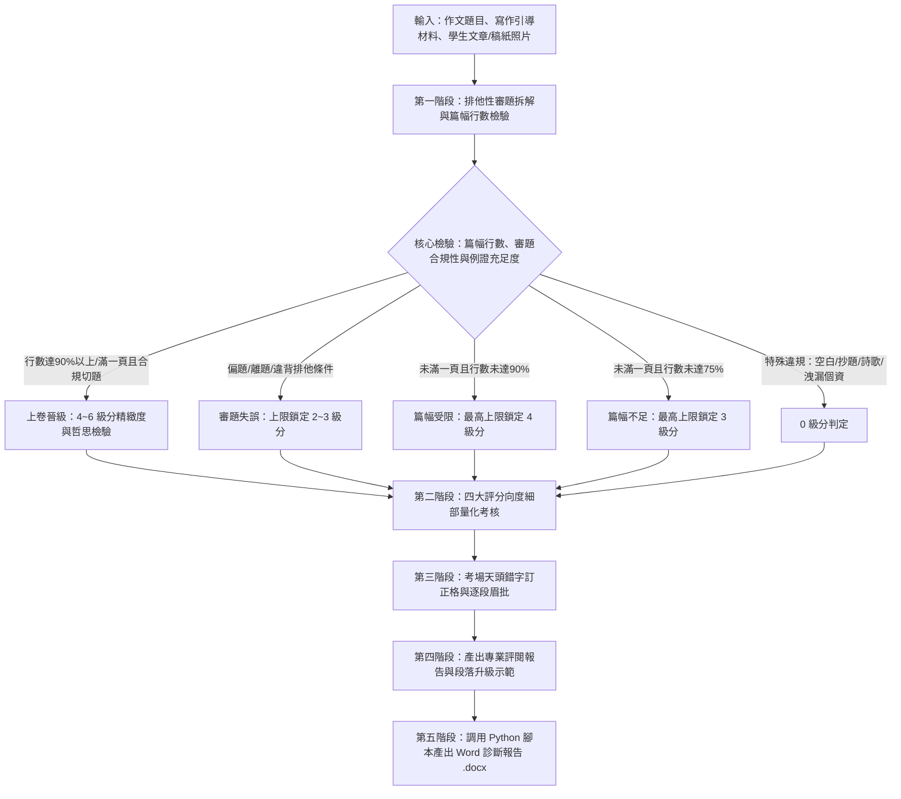

# 國中會考寫作測驗標準評審與深度評閱技能 (chinese-essay-evaluator)

本 Skill 將台灣「國中教育會考寫作測驗評分規準」與「第一線國文教師現場閱卷嚴格實戰指標」深度融合標準化，使 Antigravity 能夠針對**任何命題作文、引導式寫作或看圖寫作**，套用統一、客觀、高信度且具教育診斷意義的專業會考評分機制，產出兼具大考閱卷委員高度與第一線紅筆眉批精準度的專業評閱報告，並支援一鍵生成排版標準的 Word 診斷書。

---

## 快速使用：用戶提詞模板 (Prompt Template)

使用者可複製並填寫以下模板，快速發起專業作文評閱任務：

```markdown
請調用 /chinese-essay-evaluator 技能，依據國中教育會考標準評分規準，為以下文章進行專業評審：

1. 作文題目：〈在此輸入題目，例如：當我停下來〉
2. 引導材料或情境限制（可選）：（例如：需描寫身邊習以為常的人事物，不可寫出遊）
3. 卷面行數/篇幅（可選，若無提供則依字數估算）：約 XX 行（單頁佔比約 XX%）
4. 學生文章內容：
[在此貼上學生文章完整內容]

請產出：
- 完整 Markdown 評閱報告（含審題拆解、四大向度評定、逐段眉批、天頭錯別字訂正格、段落升級改寫）
- 調用腳本產出 Word 診斷報告 (.docx)
```

---

## 核心評審工作流程 (Workflow)



---

## 一、 第一階段：各類題目之排他性審題拆解與篇幅防守線

評閱前必須先進行題目特徵拆解與稿紙篇幅檢核，設定給分的硬性「防守線」：

### 0. 寫作篇幅與行數硬性規範（考場卷面篇幅防守線）
在標準國中教育會考稿紙（或一般測驗單頁 20~22 行）情境下，嚴格執行篇幅門檻檢驗：
1. **未寫滿一頁，且寫作行數未達 75% 以上**：
   - **最高分數上限鎖定為 3 級分（$\le 3$ 級分）**。
   - 實戰判定：篇幅嚴重不足，缺乏充分開展論述與描寫細節的空間，縱使文筆流暢或立意新穎，亦不得給予 4 級分以上。
2. **未寫滿一頁，且寫作行數未達 90% 以上（即介於 75% ～ 89% 之間）**：
   - **最高分數上限鎖定為 4 級分（$\le 4$ 級分）**。
   - 實戰判定：篇幅仍顯不足，論述完整度受限，縱使結構尚稱完整，亦**不得列入 5 級分或 6 級分（上卷）**。
3. **晉級 5~6 級分（上卷）之篇幅必要門檻**：
   - 必須**寫滿一頁之 90% 以上**（或寫滿一頁跨入第二頁），且符合各項深度標準，方具備評定為 5 級分或 6 級分的資格。

---

### 1. 情境/引導條件（Trigger / Context）
* 題目設定了什麼前提、動作或生活觀察觸發點？（例如：「當我停下來」、「在這次相遇中」）

### 2. 寫作範圍與「排他性限制」（Scope & Negative Constraints）
* 題目規定或暗示的材料範圍為何？
* **嚴格排他性檢驗**：例如題目若強調「身邊習以為常的人事物（天天能見到的）」，則寫「特殊偶發事件、專程出遊（露營、海邊看夕陽）、運動會競賽、特定重大挫折」即屬**違反限定條件**，一律判定為「舉例不符題意」或「離題」。

### 3. 「具體畫面」vs「抽象抒情」檢核（Concrete Imagery Check）
* 嚴格檢驗學生文章中是否有**視覺、聽覺或感官上的具體客觀畫面**（人物的外貌、動作、細節、環境光影）。
* 若通篇僅寫「心情放慢、放空、體會生命哲理、不要急躁」等空洞心靈雞湯，而未交代「究竟看到了什麼具體人事事物」，判定為「未扣合核心觀察」，立意取材不得評為上卷。

### 4. 取材原創性檢驗（Originality vs. Classroom Template）
* 敏銳辨識學生是否僅機械式抄錄題本範例、黑板提示或陳腔濫調（如清潔工、路邊小花草、老樹，卻無個人獨特生命細節）。若無個人真切見解，加註「取材平庸缺乏個人見解」。

### 5. 思維深度分水嶺（Core Task & Reflection）
* 是否達成由表及裡的轉化：`客觀觀察（由物入理） ➔ 人物同理與心境轉變（由理入情） ➔ 普遍價值與哲學思維`。

---

## 二、 第二階段：會考 0～6 級分綜合判定矩陣

| 級分 | 等級判定 | 綜合特徵與實戰扣分要點（含篇幅行數硬指標） |
| :---: | :---: | :--- |
| **6** | **上卷精熟 (A++)** | **篇幅達標（一頁90%以上或跨頁）**；審題完全合規；材料具體典型且具獨特見解（由物入理/情）；舉 2~3 例層次遞進，結構嚴密首尾呼應；文字精煉修辭得體；極少錯字標點精確。 |
| **5** | **上卷優良 (A+)** | **篇幅達標（一頁90%以上或跨頁）**；完整切題，有真切具體的客觀畫面與深層體悟；事例充足（2例以上），段落分明夾敘夾議；詞句流暢有變化；少有錯字與標點疏漏。 |
| **4** | **中卷穩健 (B++)** | 達到基本標準。**常出現以下情況之一（上限鎖定4級分）**：<br>① **未寫滿一頁，且行數未達 90% 以上（介於 75%～89%）**。<br>② 取材切題但停留在表面描寫，感悟平淡口號化。<br>③ **僅舉一例，內容單薄不足**。<br>④ 雖有文采但事例描寫稍欠深入。結構尚完整，字句通順。 |
| **3** | **中卷待加強 (B)** | **常踩到以下扣分地雷（上限鎖定3級分）**：<br>① **未寫滿一頁，且寫作行數未達 75% 以上**。<br>② **舉例不符題意/偏離核心限制**（如寫出遊、運動會、非習以為常之人事物）。<br>③ **通篇抽象心靈抒情，未寫出具體客觀事物畫面**。<br>④ 取材粗淺流水帳；結構鬆散，語病錯字稍多。 |
| **2** | **下卷基礎弱 (C)** | 嚴重偏題或取材貧乏殘缺；行數嚴重短缺；文句單調破碎，錯別字多，缺乏標點掌握能力。 |
| **1** | **下卷嚴重不足 (C--)** | 嚴重離題，文不成章，字數過少（僅寥寥數行），錯字連篇，無法表達完整意思。 |
| **0** | **不予給分** | 空白卷、完全離題、只抄題目說明、詩歌體、或文中洩漏個人身分。 |

詳細向度定義與得分關鍵請參閱：
* [會考官方四大向度評分規準手冊](file:///C:/Users/genie/.gemini/config/skills/chinese-essay-evaluator/references/cap_essay_rubric.md)
* [資深國文名師考場實務與評閱祕笈](file:///C:/Users/genie/.gemini/config/skills/chinese-essay-evaluator/references/teacher_grading_secrets.md)

---

## 三、 第三階段：標準評卷報告輸出格式

當執行作文批閱時，請產出包含**「篇幅行數檢核」**、**「國文老師實戰眉批」**與**「會考量規深度診斷」**的完整報告：

```markdown
# 【國中會考寫作測驗專業評閱報告】

### 壹、 題目、篇幅檢核與審題拆解
* **寫作題目**：〈題目名稱〉
* **卷面篇幅與行數檢核**：
  - 估計行數與佔比：共約 XX 行（單頁佔比約 XX%）
  - 篇幅門檻判定：【未滿一頁且未達75%（上限鎖定3級分） / 未滿一頁且未達90%（上限鎖定4級分） / 達90%以上或跨頁（具備5-6級評定資格）】
* **審題要旨與排他性限制檢驗**：
  - 情境與核心任務：...
  - 排他性限定條件檢驗（是否屬限定範圍？）：...【合格 / 偏題警示】
  - 具體客觀畫面檢驗（是否有視覺/感官細節？）：...【合格 / 抽象警示】
  - 取材原創性檢驗（是否為課堂/提示樣板？）：...【具個人見解 / 樣板複製】

---

### 貳、 總體評定結果
* **最終評定級分**：**【 X 級分 】**（對應等第：上卷/中卷/下卷）
* **國文老師紅筆總評（考場視角一句話短評）**：...

#### 各向度量化評估矩陣：
| 向度 | 表現等級 (1~6級) | 核心診斷亮點與硬傷 |
| :--- | :---: | :--- |
| **篇幅與行數** | 符合/受限 (上限X級) | （檢視單頁行數佔比：<75%鎖定3級、<90%鎖定4級、>=90%具5-6級資格） |
| **立意取材** | X 級 | （檢視切題度、具體畫面深度、是否有新發現新感受） |
| **結構組織** | X 級 | （檢視例證數量是否充足[幾例]、是否一例一段、首尾呼應） |
| **遣詞造句** | X 級 | （檢視文筆流暢度、修辭變化、口語贅字） |
| **錯別字與標點** | X 級 | （檢視錯字率、一逗到底、標點精確度） |

---

### 參、 國文老師實戰眉批與四大向度深度剖析

#### 一、 立意取材（思維深度、排他性審題與原創見解）
* **亮點**：...
* **致命傷/限制**：...（嚴格指出：是否有離題？是否缺乏具體看到的畫面？感悟是否流於口號？）

#### 二、 結構組織（篇幅完整性、例證充足性、段落佈局與呼應）
* **篇幅與例證評估**：行數佔比 XX%，舉了 X 個例子【充足（2~3例）/ 不足（僅1例或篇幅未達標）】
* **佈局檢討**：...（是否落實一例一段？結論段是否具體總結回扣上述事例？）

#### 三、 遣詞造句（文采、語病與贅字刪修）
* **文采佳句摘錄**：
  > 「...」
* **冗詞、語病或口語化刪修**：
  > 原句：...
  > 建議修訂：...

#### 四、 考場天頭錯別字訂正格與標點檢核
* **天頭錯別字訂正格**：
  - `錯字` 口 ➔ 正字：`【 正字 】`
  - `錯字` 口 ➔ 正字：`【 正字 】`
* **標點符號與排版扣分項**：...（如：逗號改句號、分號運用）

---

### 肆、 逐段批註與脈絡診斷
* **第一段（起 / 開篇破題）**：...
* **第二段（承 / 第一事例展開）**：...
* **第三段（轉 / 第二事例深入）**：...
* **第四段（合 / 總結回扣昇華）**：...

---

### 伍、 突破瓶頸：段落升級處方與修改示範
* **核心升級痛點**：（例如：如何擴充篇幅超越 90% 門檻、克服「僅舉一例」或將「抽象抒情」轉化為「具體生活特寫」）
* **【段落改寫示範】**：
  * **原始段落**：
    > ...
  * **升級示範（注入生活細節刻畫、由物入理、映襯修辭、豐富篇幅）**：
    > ...
  * **改寫要訣點撥**：...
```

---

## 四、 第四階段：自動化產出 Word 診斷報告 (.docx)

本技能附帶自動化報表生成工具 `scripts/essay_report_builder.py`，支援一鍵將診斷數據與評析轉為符合 A4 列印標準的排版 Word 文件。

### 執行命令範例：
```bash
python scripts/essay_report_builder.py \
  --topic "當我停下來" \
  --score 4 \
  --tier "中卷穩健 (B++)" \
  --output "C:\codeSpace\作文診斷報告_當我停下來.docx" \
  --data-json report_data.json
```

或傳入完整 JSON 評閱數據字典生成排版完整的診斷專頁。

---

## 五、 參考資源目錄 (References)

本 Skill 採用 Antigravity Progressive Disclosure 架構，詳細專業背景與案例資料請直接查閱：
1. **[cap_essay_rubric.md](file:///C:/Users/genie/.gemini/config/skills/chinese-essay-evaluator/references/cap_essay_rubric.md)**：教育部心測中心國中教育會考寫作測驗 0~6 級分官方評分規準手冊、立意取材/結構組織/遣詞造句/錯別字格式四大向度細部定義。
2. **[teacher_grading_secrets.md](file:///C:/Users/genie/.gemini/config/skills/chinese-essay-evaluator/references/teacher_grading_secrets.md)**：第一線國文科資深教師閱卷實戰指標、篇幅防守線（<75% 鎖 3 級、<90% 鎖 4 級）、一例一段結構法、天頭錯別字訂正格式。
3. **[sample_prompts_and_upgrades.md](file:///C:/Users/genie/.gemini/config/skills/chinese-essay-evaluator/references/sample_prompts_and_upgrades.md)**：歷屆會考經典題目審題剖析（〈當我停下來〉、〈在這次相遇中〉、〈不必成為別人眼中的模範〉）及由 3-4 級分躍升至 5-6 級分之段落改寫示範。

---

## 六、 交付前自我查核清單 (Pre-delivery Checklist)

在向使用者交付評閱報告前，請務必逐一核對以下 10 項標準：
- [ ] 1. **篇幅防守線檢核**：是否已依行數比例（<75% 或 <90%）正確設定級分上限，無違規越級？
- [ ] 2. **排他性審題檢驗**：是否嚴格檢視文章材料是否違反題目的負向或排他限制（如嚴禁出遊、必須為日常身邊人事物）？
- [ ] 3. **具體客觀畫面**：是否有檢驗出學生是否通篇空洞抒情，是否有點出具體可見之人事物特寫？
- [ ] 4. **事例數量統計**：是否在結構評析中明確點出舉了幾個事例，並指出「僅舉一例」之篇幅單薄硬傷？
- [ ] 5. **四大向度量化表**：是否產出包含立意、結構、造句、標點錯字之等級與核心亮點硬傷表格？
- [ ] 6. **國文老師紅筆總評**：是否提供具備考場一線視角、一針見血的總評？
- [ ] 7. **天頭錯別字訂正格**：是否挑出實際錯字，並以 `錯字 口 ➔ 正字` 格式呈現？
- [ ] 8. **逐段脈絡剖析**：是否針對起承轉合各段落給出具體且具建設性的診斷反饋？
- [ ] 9. **段落升級改寫示範**：是否提供針對該生短板的原段落 vs. 升級改寫示範與改寫要點？
- [ ] 10. **Word 報告產出**：是否主動告知或調用 `scripts/essay_report_builder.py` 產出排版優美的 `.docx` 報告？
