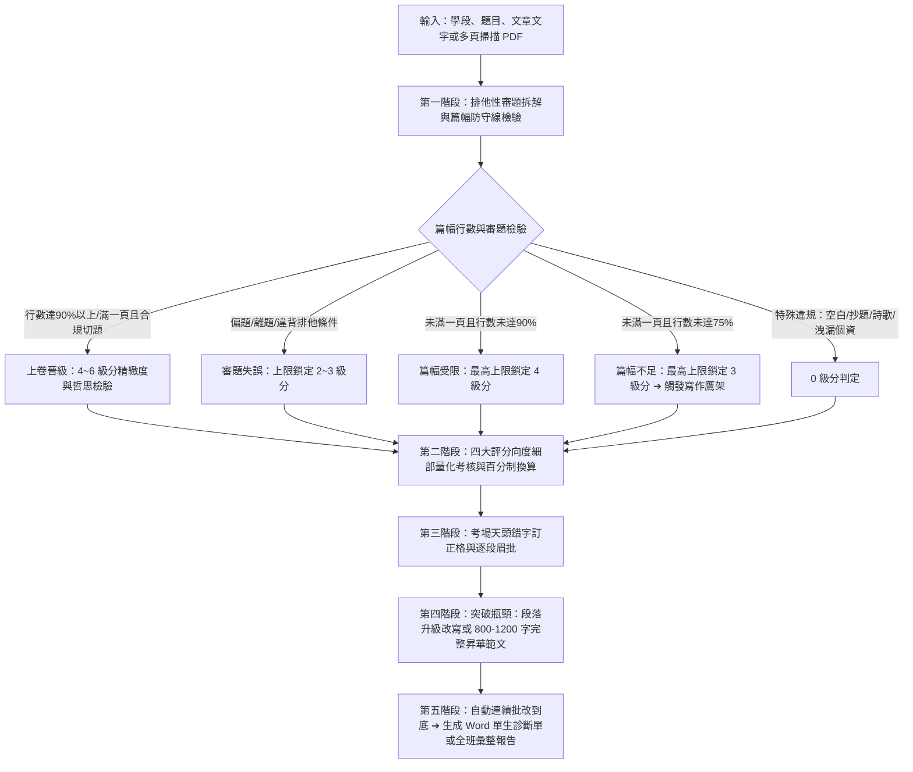

# 中文作文與會考寫作測驗專業評審・教學診斷手冊 (chinese-essay-evaluator)

本 Skill 專門針對**國中教育會考寫作測驗、國小高年級作文習作、各級模擬考、命題作文、引導式寫作或看圖寫作**，套用統一、客觀、高信度且具教育診斷意義的專業評審機制。

不僅扮演**「大考閱卷委員」**嚴格把關排他性審題、篇幅防守線與天頭錯字，更扮演**「第一線國文教學名師」**，提供字數不足時的寫作鷹架、完整昇華範文、逐段眉批與全班批量 Word 成果冊。

---

## 🎯 雙軌學段設定 (Grade Adaptation)

批閱前依據學生學段自動切換評定標準與範文規模：
* **國中階段（含會考衝刺）**：
  * **評分規準**：心測中心會考六級分規準（6級分 95~100分；5級分 85~94分；4級分 75~84分；3級分 65~74分；2級分 50~64分；1級分 50分以下）。
  * **篇幅防守線**：稿紙單頁行數 $<75\%$ 上限鎖定 3 級分；$<90\%$ 上限鎖定 4 級分。
  * **示範範文**：**800 ~ 1200 字完整全文**。
* **國小階段（中高年級）**：
  * **評分規準**：教育部國小語文課綱能力指標（側重標點完整、通順記事、修辭感受）。
  * **示範範文**：**400 ~ 800 字完整全文**。

---

## 快速使用：用戶提詞模板 (Prompt Template)

```markdown
請調用 /chinese-essay-evaluator 技能進行專業作文評審：

1. 學段與年級：【國中九年級 / 國小五年級】
2. 作文題目：〈在此輸入題目，例如：當我停下來〉
3. 引導材料或情境限制（可選）：（例如：需描寫身邊習以為常的人事物，不可寫出遊）
4. 卷面行數/篇幅（可選）：約 XX 行（單頁佔比約 XX%）
5. 學生文章內容（或上傳手寫 PDF / 圖片）：
[在此貼上學生文章完整內容，或指定 PDF 檔案路徑]

請產出：
- 完整 Markdown 評閱報告（含審題拆解、四大向度評定、逐段眉批、天頭錯字訂正格、寫作進階鷹架/段落升級）
- 調用 scripts/essay_report_builder.py 產出專業排版 Word 診斷報告 (.docx)
```

---

## 核心評審工作流程 (Workflow)



---

## 一、 第一階段：排他性審題拆解與篇幅防守線

### 0. 寫作篇幅與行數硬性規範（國中會考防守線）
在標準國中教育會考稿紙（單頁 20~22 行）情境下：
1. **未寫滿一頁，且寫作行數未達 75% 以上**：
   - **最高分數上限鎖定為 3 級分（$\le 3$ 級分）**。
   - 實質判定：缺乏開展空間，縱使文筆流暢亦不得給 4 級分以上。**強制觸發【寫作進階鷹架】**。
2. **未寫滿一頁，且寫作行數未達 90% 以上（介於 75% ～ 89% 之間）**：
   - **最高分數上限鎖定為 4 級分（$\le 4$ 級分）**。不得列入 5 級分或 6 級分（上卷）。
3. **晉級 5~6 級分（上卷）之篇幅必要門檻**：
   - 必須**寫滿一頁之 90% 以上**（或寫滿一頁跨入第二頁），方具備評定資格。

### 1. 寫作範圍與「排他性限制」（Scope & Negative Constraints）
* **嚴格排他性檢驗**：若題目強調「日常天天見到的人事物」，寫「罕見出遊、特定競賽」即屬離題。

### 2. 「具體客觀畫面」vs「抽象抒情」檢核
* 嚴格檢驗是否有**視覺、聽覺等具體感官畫面**。通篇僅寫「心情放慢、體會人生」而無客觀事物特寫者，立意取材不得給上卷。

---

## 二、 第二階段：會考 0～6 級分綜合判定矩陣

| 級分 | 百分制 | 等級判定 | 綜合特徵與扣分要點 |
| :---: | :---: | :---: | :--- |
| **6** | 95~100 | **上卷精熟 (A++)** | 篇幅達標（一頁90%以上或跨頁）；審題合規；取材具體深刻（由物入理/情）；舉 2~3 例層次遞進；極少錯字標點精確。 |
| **5** | 85~94 | **上卷優良 (A+)** | 篇幅達標；切題有具體客觀畫面與深層體悟；事例充足（2例以上）；詞句流暢有變化；少有錯字疏漏。 |
| **4** | 75~84 | **中卷穩健 (B++)** | 達基本標準。**常現以下情形之一（上限鎖定4級分）**：<br>① 未寫滿一頁且行數未達90%（75%~89%）。<br>② 取材切題但停留在表面，感悟口號化。<br>③ 僅舉單一事例單薄不足。 |
| **3** | 65~74 | **中卷待加強 (B)** | **常踩扣分地雷（上限鎖定3級分）**：<br>① 未寫滿一頁且行數未達75%。<br>② 舉例不符題意/違背排他條件。<br>③ 通篇抽象雞湯無具體畫面。<br>④ 取材流水帳，錯字稍多。 |
| **2** | 50~64 | **下卷基礎弱 (C)** | 嚴重偏題或取材貧乏；行數嚴重短缺；文句破碎，錯別字多。 |
| **1** | <50 | **下卷嚴重不足 (C--)** | 嚴重離題，文不成章，字數過少，錯字連篇。 |
| **0** | 0 | **不予給分** | 空白卷、完全離題、只抄題本、詩歌體、洩漏個人身分。 |

---

## 三、 第三階段：寫作進階鷹架與範文示範

### 1. 寫作進階鷹架（Scaffold，字數不足或單薄時強制啟動）
當學生字數 $<500$ 字或鎖定 3 級分時，報告必須具備：
1. **細節擴寫引導**：針對原文空白處，提出 2-3 個具體情境引導提問（如：對方的眼神變化？當時周圍的光影與聲音？）。
2. **五感描摹錦囊**：提供視覺、聽覺、觸覺等具體描摹手法。
3. **邏輯與情感深度反思**：引導由物入理，從記事昇華至生命哲思。

### 2. 老師示範寫作（完整版 800 ~ 1200 字）
* 依據該生的核心取材與靈光，重新昇華重寫為符合 6 級分（A++）水準的完整範文。**絕不節錄，完整呈現開頭、鋪陳、轉折與昇華**。

---

## 四、 第四階段：手寫掃描檔 (PDF/圖片) 批次自動管線

當收到學生手寫掃描 PDF 或圖片資料夾時：
1. **頁數與學生篇數判定**：調用 `scripts/pdf_essay_extractor.py` 將 PDF 解構為高解析度圖檔。
2. **自動連續批改到底**：**取消批次中斷**，依序批改每位學生，無需使用者多次點擊「繼續」。
3. **整合匯出 Word 手冊**：調用 `scripts/essay_report_builder.py` 輸出整班成果報告。

---

## 五、 第五階段：Word (.docx) 輸出排版規範

批閱成果一律使用 `scripts/essay_report_builder.py` 自動產出精美 Word 報告：

1. **單生獨立診斷單模式**：
   - 適合個人列印回饋，包含資訊 Banner、級分評定、四大向度矩陣、天頭錯字訂正格、逐段批註、段落升級與進階鷹架。
2. **全班彙整手冊模式 (Class-wide Batch Report)**：
   - **首頁**：全班成績總覽表（座號、姓名、題目、會考級分、百分制、短評），6 級分綠色高亮。
   - **強制換頁**：封面結束後強制分頁（`Page Break`）。
   - **學生專章**：每位學生結束後嚴格執行強制分頁，確保一人專屬篇幅，絕不擠在同頁。
   - **全班教學診斷專頁**：獨立於最後一頁，包含全班失分死穴分析與課堂對讀研討活動設計。

### 執行範例：
```bash
# 單生報告產出
python scripts/essay_report_builder.py --topic "當我停下來" --student "901班 05號 李同學" --score 4 --output "李同學作文診斷單.docx"

# 全班或進階 JSON 產出
python scripts/essay_report_builder.py --data-json "class_results.json" --output "全班寫作評閱手冊.docx"
```

---

## 六、 交付前自我查核清單 (Pre-delivery Checklist)

- [ ] 1. **學段匹配**：是否已依國中或國小正確切換評分標準與範文長度？
- [ ] 2. **篇幅防守線**：是否落實 $<75\%$ 鎖 3 級分、$<90\%$ 鎖 4 級分？
- [ ] 3. **排他性審題**：是否抓出離題舉例（如日常題目寫出遊）？
- [ ] 4. **客觀畫面檢核**：是否區分具體特寫與空洞抽象抒情？
- [ ] 5. **天頭錯別字格**：是否以 `錯字 口 ➔ 正字：【 正字 】` 呈現？
- [ ] 6. **進階鷹架/範文**：字數不足是否提供鷹架？是否提供升級示範或完整版示範範文？
- [ ] 7. **批次不中斷**：若是全班檔案，是否自動全部批改到底？
- [ ] 8. **Word 報告排版**：是否調用腳本生成 Word，且學生間與封面嚴格執行強制換頁？
