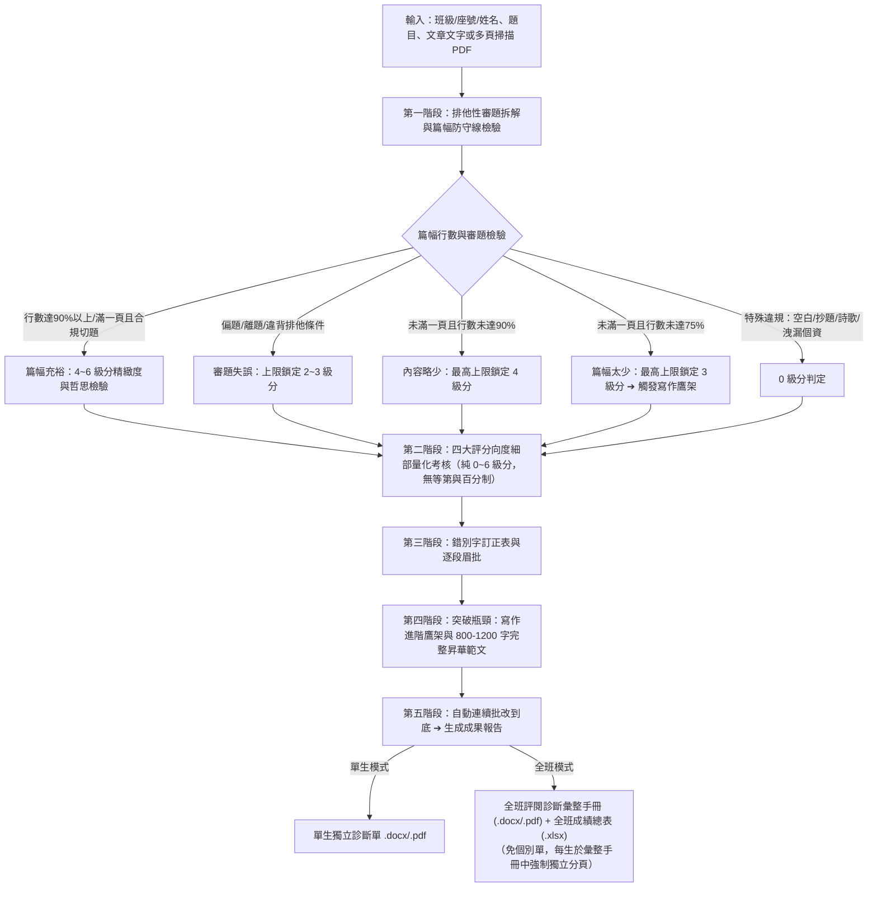

# 中文作文與會考寫作測驗專業評審・教學診斷手冊 (chinese-essay-evaluator)

本 Skill 專門針對**國中教育會考寫作測驗、國小高年級作文習作、各級模擬考、命題作文、引導式寫作或看圖寫作**，套用統一、客觀、高信度且具教育診斷意義的專業評審機制。

不僅扮演**「大考閱卷委員」**嚴格把關排他性審題、篇幅防守線與天頭錯字，更扮演**「第一線國文教學名師」**，提供字數不足時的寫作鷹架、完整昇華範文、逐段眉批與全班批量 Word 成果冊。

---

## 🎯 雙軌學段設定 (Grade Adaptation)

批閱前依據學生學段自動切換評定標準與範文規模：
* **國中階段（含會考衝刺）**：
  * **評分規準**：臺師大心測中心官方六級分評分規準（詳見 [cap_essay_rubric.md](references/cap_essay_rubric.md)，官方來源：[https://cap.rcpet.edu.tw/exam3-1.html](https://cap.rcpet.edu.tw/exam3-1.html)；6級分 95~100分；5級分 85~94分；4級分 75~84分；3級分 65~74分；2級分 50~64分；1級分 50分以下）。
  * **篇幅防守線**：稿紙單頁行數 $<75\%$ 上限鎖定 3 級分；$<90\%$ 上限鎖定 4 級分。
  * **示範範文**：**800 ~ 1200 字完整全文**。
* **國小階段（中高年級）**：
  * **評分規準**：教育部國小語文課綱能力指標（側重標點完整、通順記事、修辭感受）。
  * **示範範文**：**400 ~ 800 字完整全文**。

---

## ⚖️ 預設給分尺度守則 (Default Grading Policy)

> 🔔 **重要預設政策**：
> 凡使用者**未明確指定給分尺度**（例如未特別聲明「寬鬆鼓勵給分」或「國小入門習作」）時，本 Skill **預設一律啟動【會考高標閱卷／從嚴評定】模式**，落實第一線閱卷名師防守線：
> 1. **俗套選材防守線（4 級分上限）**：取材於生病發燒、段考失利、跑步受傷、長輩去世等考場爛熟俗套，若無突破常規的深刻哲思視角，立意取材最高鎖定 4 級分。
> 2. **單一事例防守線（4 級分上限）**：通篇僅舉單一事例且未具備多層次對照遞進者，論證開展單薄，上限鎖定 4 級分；晉升 5～6 級分必須具備 2 個以上事例層次遞進。
> 3. **客觀特寫檢核（無畫面不給 5 級分）**：通篇僅有抽象抒情、雞湯大道理而無具體客觀畫面（光影、動作、聲響特寫）者，不得評入 5 級分以上。
> 4. **邊界爭議從嚴降級**：在級分邊界（如 4/5 級分、5/6 級分徘徊）若存在錯別字、病句、口語贅字或篇幅爭議，一律從嚴判定為較低級分。

---

## 💡 善解人意與零設定智慧推定原則 (Empathetic Zero-Config Defaults)

當教師給予模糊、簡短或僅提供檔案路徑之指令（例如：「批閱 705 班作文」、「幫我改這資料夾裡的作文」）時，本 Skill **嚴禁向使用者拋回連珠炮式的繁瑣設定提問**，應主動啟動「善解人意」智慧推定機制：

1. **題目與班級智慧推定**：
   - 自動由父資料夾名稱、檔案名稱或掃描首頁作文稿紙擡頭推定**班級**（如 `705`、`901班`）與**寫作題目**（如〈記憶中的滋味〉、〈當我停下來〉）。
   - 若無法 100% 確定題目，以首頁稿紙題目為準自動推進，並於最終回報中友善附註說明。
2. **學段與防守線自動適配**：
   - 檔名或資料夾含 `7xx`、`8xx`、`9xx`、`七/八/九年級`、`國中`、`會考` 或 `模考` 者，自動套用「國中會考衝刺／從嚴高標閱卷」模式，無須向教師確認。
   - 含 `小學`、`五年級`、`六年級` 等字樣自動適配國小課綱常規模式。
3. **掃描方向與原圖智慧處理**：
   - 預設一律**不插入學生手寫原卷圖檔**於 Word/PDF 報告中（徹底維持檔案輕巧精美，預防傳輸與列印卡頓）。
   - 自動檢驗 PDF 旋轉角度，若偶數頁顛倒自動局部 180° 轉正，無需教師手動轉檔。
4. **座號排序與卷面筆誤容錯校準**：
   - 優先以檔案名稱中的座號（如 `01.pdf`、`22.pdf`）作為班級法定學號排序基準，全班嚴格按 1 號至 40 號遞增排序。
   - 若學生於卷面座號欄自填筆誤（例如檔名為 22 號，卷面卻手寫 10 號），系統**不報錯、不中斷批閱**，自動記錄為「法定 22 號（卷面自填 10 號）」，並於 Excel 總表與手冊封面勘誤備註提示教師。
5. **對話框交付看板原則（防止洗版與脈絡溢出）**：
   - 批閱全班數十位學生時，**嚴禁在聊天對話框中一口氣傾倒全班每位學生數萬字的完整範文與逐段眉批**！
   - 所有詳盡內容已完整保存在 Word 成果手冊與 Excel 總表中。對話視窗應呈現典雅精簡的**「名師教學診斷看板」**。

---

## 快速使用：用戶提詞模板 (Prompt Template)

### 模板一：標準評審模式（單篇適中給分 / 官方常態規準）

```markdown
請調用 /chinese-essay-evaluator 技能進行專業作文評審：

1. 學段與年級：【國中九年級 / 國小五年級】
2. 作文題目：〈在此輸入題目，例如：當我停下來〉
3. 引導材料或情境限制（可選）：（例如：需描寫身邊習以為常的人事物，不可寫出遊）
4. 卷面行數/篇幅（可選）：約 XX 行（單頁佔比約 XX%）
5. 學生文章內容（或上傳手寫 PDF / 圖片）：
[在此貼上學生文章完整內容，或指定 PDF 檔案路徑]

請產出：
- 完整 Markdown 評閱報告（含審題拆解、四大向度評定、錯別字訂正表、逐段眉批、寫作進階鷹架/段落升級）
- 調用 scripts/essay_report_builder.py 產出專業排版 Word 診斷報告 (.docx)
```

### 模板二：嚴格評審模式（單篇會考高標閱卷 / 衝刺拔尖篩選）

```markdown
/chinese-essay-evaluator
請依據【嚴格給分標準 / 會考高標閱卷模式】進行專業批改：

1. 班級/座號/姓名：901 班 15 號 陳同學
2. 作文題目：〈當我停下來〉
3. 給分尺度：【從嚴評定（高標篩選）】
   - 俗套選材（如考試、生病）若無新穎視角，立意上限鎖定 4 級分。
   - 單一事例絕不給 5 級分以上。
   - 錯字、病句與口語贅字從嚴挑出並在級分邊界從嚴降級。
4. 學生文章內容（或上傳手寫 PDF / 圖片）：
   [在此貼上文章內容或檔案路徑]
```

### 模板三：兩階段工作流－階段一【命題與嚴格評審準則規畫】（產出規畫書 .docx）

```markdown
/chinese-essay-evaluator 【階段一：命題與評審準則規畫】

請針對以下寫作題目與引導材料，產出一份《嚴格評審準則規畫書》Word 檔（.docx）：

1. 學段與年級：國中九年級（會考衝刺標準）
2. 作文題目：〈當我停下來〉
3. 引導寫作說明／情境限制：
   [在此貼上引導說明，例如：以身邊天天見得到的人事物為觀察核心，不可寫罕見出遊或補習班生活]
4. 給分尺度要求：
   - 採【會考高標／嚴格閱卷】模式
   - 俗套選材（如生病發燒、段考失利）若無深刻新視角，立意上限鎖定 4 級分
   - 單一事例上限鎖定 4 級分，必須有客觀具體畫面特寫（視覺/聽覺等）
   - 明確定義切題、踩線、偏題之排他性條件
5. 預計儲存路徑：[例如：D:\作文批改\九年級模考\當我停下來_嚴格評審準則規畫書.docx]
```

### 模板四：兩階段工作流－階段二【依規畫書批量批閱】（指定資料夾與規畫書，同目錄存檔）

```markdown
/chinese-essay-evaluator 【階段二：依規畫書批量批閱】

我已確認評審準則，請嚴格依照該規畫書，對指定資料夾內的所有作文進行自動批閱：

1. 評審準則規畫書路徑：
   [例如：D:\作文批改\九年級模考\當我停下來_嚴格評審準則規畫書.docx]
2. 學生作文資料夾路徑：
   [例如：D:\作文批改\九年級模考\901班作文\]
   （資料夾內包含學生手寫掃描 PDF 或圖檔）
3. 執行與輸出要求：
   - 自動連續批閱到底，無需每篇中斷確認
   - 嚴格落實規畫書中的篇幅防守線、排他性審題與錯字段落出處前後文定位
   - 成果檔案請【直接儲存在與學生作文相同的目錄下】（批閱全班時無需產生個別學生單獨診斷單，僅需全班彙整成果）：
     * 全班作文評閱診斷彙整手冊（.docx 與同名高畫質向量 .pdf，封面總表＋每生強制獨立分頁專章＋全班教學診斷專頁）
     * 全班成績總表（.xlsx，雙 Sheet：向度明細表 + 常模統計表）
```

---

## 核心評審工作流程 (Workflow)

### 模式 A：單篇/批次即時評審流


### 模式 B：兩階段人機協同 (HITL) 命題規畫與批閱管線
```mermaid
flowchart TD
    subgraph S1["【階段一：命題與規畫書生成】"]
        T1[輸入：題目與引導說明] --> T2["調用 scripts/rubric_plan_builder.py"]
        T2 --> T3["產出《[題目]_嚴格評審準則規畫書.docx》"]
    end

    subgraph CP["【人機確認節點 (HITL)】"]
        T3 --> T4{老師審核與確認}
        T4 -->|同意原稿 或 指定微調後之規畫書| T5[鎖定評分標準 (Ground Truth)]
    end

    subgraph S2["【階段二：依規畫書批量批閱】"]
        T5 --> T6[指定學生作文資料夾]
        T6 --> T7["自動讀取規畫書規準 ➔ 遍歷作文檔案 (PDF/圖片/文字)"]
        T7 --> T8["自動連續批閱到底 ➔ 調用 scripts/ 工具鏈產出報告"]
        T8 --> T9["儲存於【與作文檔案相同之目錄】：<br>1. 全班作文評閱診斷彙整手冊 (.docx / .pdf)<br>2. 全班成績總表 (.xlsx)<br>（批閱全班時不產生每一位個別學生之單獨診斷單）"]
    end
```

---

## 一、 第一階段：排他性審題拆解與篇幅防守線

### 0. 寫作篇幅與行數硬性規範（國中會考防守線）
在標準國中教育會考稿紙（單頁 20~22 行）情境下：
1. **未寫滿一頁，且寫作行數未達 75% 以上**：
   - **最高分數上限鎖定為 3 級分（$\le 3$ 級分）**。
   - 實質判定：缺乏開展空間，縱使文筆流暢亦不得給 4 級分以上。**強制觸發【寫作進階鷹架】**。
2. **未寫滿一頁，且寫作行數未達 90% 以上（介於 75% ～ 89% 之間）**：
   - **最高分數上限鎖定為 4 級分（$\le 4$ 級分）**。不得列入 5 級分或 6 級分。
3. **晉級 5~6 級分之篇幅必要門檻**：
   - 必須**寫滿一頁之 90% 以上**（或寫滿一頁跨入第二頁），方具備評定資格。

> ⚠️ **診斷內容呈現原則**：篇幅防守線之數字（如 75%、90%、行數等）**僅供閱卷批核分數使用，切勿直接呈現在給學生的診斷報告中**。請統一使用「篇幅太少」、「內容略少」、「篇幅充裕」等直覺質性用語呈現。

### 1. 寫作範圍與「排他性限制」（Scope & Negative Constraints）
* **嚴格排他性檢驗**：若題目強調「日常天天見到的人事物」，寫「罕見出遊、特定競賽」即屬離題。

### 2. 「具體客觀畫面」vs「抽象抒情」檢核
* 嚴格檢驗是否有**視覺、聽覺等具體感官畫面**。通篇僅寫「心情放慢、體會人生」而無客觀事物特寫者，立意取材不得給上卷。

---

## 二、 第二階段：會考 0～6 級分綜合判定矩陣

診斷報告**僅呈現純粹 0 到 6 級分之整數成績**，不顯示百分制換算或「中卷穩健(B++)」等分流標籤：

| 綜合會考級分 | 綜合特徵與扣分要點 |
| :---: | :--- |
| **6 級分** | 篇幅充裕（滿頁或跨頁）；審題合規；取材具體深刻（由物入理/情）；舉 2~3 例層次遞進；極少錯字標點精確。 |
| **5 級分** | 篇幅充裕；切題有具體客觀畫面與深層體悟；事例充足（2例以上）；詞句流暢有變化；少有錯字疏漏。 |
| **4 級分** | 達基本標準。**常現以下情形之一（上限鎖定4級分）**：<br>① 內容略少（未滿一頁且行數未達90%）。<br>② 取材切題但停留在表面，感悟口號化。<br>③ 僅舉單一事例單薄不足。 |
| **3 級分** | **常踩扣分地雷（上限鎖定3級分）**：<br>① 篇幅太少（未滿一頁且行數未達75%）。<br>② 舉例不符題意/違背排他條件。<br>③ 通篇抽象雞湯無具體畫面。<br>④ 取材流水帳，錯字稍多。 |
| **2 級分** | 嚴重偏題或取材貧乏；行數嚴重短缺；文句破碎，錯別字多。 |
| **1 級分** | 嚴重離題，文不成章，字數過少，錯字連篇。 |
| **0 級分** | 空白卷、完全離題、只抄題本、詩歌體、洩漏個人身分。 |

---

## 三、 第三階段：錯別字訂正表與逐段眉批

### 1. 錯別字訂正表（段落出處與原句脈絡定位）
為徹底杜絕傳統人工或模型點驗「第幾行第幾格」容易受直式稿卷版型、空格或行距偏差干擾的問題，本 Skill 一律改採**「所在段落 ＋ 前後文句原句脈絡（上下文）」精準定位錯字**，兼顧快速尋找、零誤差對位與語境診斷效益。評閱報告與 Word 檔一律採用**教學直覺型 4 欄表格化**呈現：

* **標題名稱**：**「貳、 錯別字訂正表」**
* **出處定位格式**：`第 {段} 段：「……[前文][錯字詞語][後文]……」`（摘錄包含該錯字之完整句或短語，如：`第 1 段：「……走在放學的路上，我常常看見自已的影子……」`、`第 3 段：「……聞到廚房飄來的香味，我迫不及待地跑過去……」`）。
* **表格結構規範**：
  | 錯字詞語 | 所在段落與原句脈絡 | 錯誤字修正 | 語境訂正與字義解析 |
  | :---: | :--- | :---: | :--- |
  | **自已** | 第 1 段：「……走在放學的路上，我常常看見自已的影子……」 | 已 ➔ 己 | 應為「自己」（指自身），不可誤寫為已經之「已」。 |
  | **迫不及待** | 第 3 段：「……聞到廚房飄來的香味，我迫不及待地跑過去……」 | 及 ➔ 急 | 應為「迫不及待」（急迫得不能等待），「及」為趕上之意，不可混淆。 |
* **無錯字獎勵機制**：若通篇無錯別字，顯示：
  > 🌟 **太棒了！本次卷面書寫嚴謹，無明顯錯別字，請繼續保持高水準之文字正確性！**
* **強制表格化呈現（嚴禁文字條列）**：無論在聊天對話、Markdown 診斷單或 Word 報告中，**嚴禁以純文字條列（如 `錯字 ➔ 正字`）列出錯別字**，必須一律使用標準 4 欄 Markdown 表格或調用 `scripts/essay_report_builder.py` 產出原生 Word 4 欄表格！

### 2. 逐段眉批
依據文章實際段落，逐段給予「優點亮點（金句特寫）」與「失分痛點（思維邏輯/修辭病句）」，指出段落核心問題與調整方針。

---

## 四、 第四階段：寫作進階鷹架與範文示範

### 1. 寫作進階鷹架（Scaffold，字數不足或單薄時強制啟動）
當學生字數 $<500$ 字或鎖定 3 級分時，報告必須具備：
1. **細節擴寫引導**：針對原文空白處，提出 2-3 個具體情境引導提問（如：對方的眼神變化？當時周圍的光影與聲音？）。
2. **五感描摹錦囊**：提供視覺、聽覺、觸覺等具體描摹手法。
3. **邏輯與情感深度反思**：引導由物入理，從記事昇華至生命哲思。

### 2. 老師示範寫作（完整版 800 ~ 1200 字）
* 依據該生的核心取材與靈光，重新昇華重寫為符合 6 級分水準的完整範文。**絕不節錄，完整呈現開頭、鋪陳、轉折與昇華**。

---

## 五、 第五階段：手寫掃描檔 (PDF/圖片) 批次自動管線

當收到學生手寫掃描 PDF 或圖片資料夾時：
1. **頁數、篇數判定與版面轉正**：
   - 調用 `scripts/pdf_essay_extractor.py` 將 PDF 解構為高解析度圖檔。
   - **上下顛倒轉正（支援全檔或指定局部頁面）**：
     - 若**全部頁面**顛倒：直接執行 180° 全檔轉正。
     - 若**僅部份頁面**顛倒（例如雙面掃描時背面偶數頁顛倒，或僅第 2、4 頁顛倒）：工具支援 `--pages` 參數指定頁碼（如 `--pages even` 針對偶數頁、或 `--pages 2,4,7-9`），**只轉正顛倒的頁面，其餘正向頁面完全不動**！
     - 支援同步產出實體備份：`[檔名]_已轉正.pdf`。
2. **自動連續批改到底**：**取消批次中斷**，依序批改每位學生，無需使用者多次點擊「繼續」。
3. **整合匯出全班雙重成果（無需產出個別學生單獨檔案）**：全班批閱情境下，**不需要產生每一位個別學生的診斷單**，只要一份全班的彙整手冊即可。調用 `scripts/class_excel_generator.py` 產出全班 Excel 總表，並調用 `scripts/essay_report_builder.py` 產出全班評閱診斷彙整手冊之 Word 與同名向量 PDF 雙檔（每生一律於彙整手冊內獨立分頁專章呈現，便於整體檢視與裝訂列印）。

---

## 六、 第六階段：成果報告交付規範（全班手冊 Word/PDF + Excel 成績總表）

批閱完成後，系統依批閱情境交付成果：
* **單生批閱模式**：產出該生單獨之 Word 診斷單與同名向量 PDF。
* **全班/多生批閱模式**：**嚴格落實「三合一極簡交付原則」，嚴禁產生任何個別學生之零散單獨檔案，全班僅產出且只產出以下 3 個核心檔案**（一鍵同步存放在作文目錄下）：

1. **班級學生作文成績總表 Excel (`*.xlsx`)**：
   - 調用 `scripts/class_excel_generator.py` 自動生成二合一試算表：
     - **Sheet 1【全班成績與向度明細表】**：包含【座號、姓名、寫作題目、綜合會考級分（色彩階梯高亮）、立意取材、結構組織、遣詞造句、錯別字與標點、卷面篇幅檢核（質性詞）、錯別字數、錯字訂正摘要、名師總評】共 12 大核心欄位；具備凍結窗格（凍結座號姓名）與自動篩選功能。
     - **Sheet 2【級分常模與統計圖表】**：包含應試人數、全班平均級分、0~6級分常模人數與佔比分佈表、四大評審向度平均得分診斷方針、全班常見錯別字盲點排行。
2. **全班作文評閱診斷彙整手冊 (`.docx` 與同名高畫質向量 `.pdf`)**：
   - 包含封面全班成績總覽表、每生獨立專頁（強制換頁獨立成章）、全班整體教學診斷專頁。
   - 工具鏈會自動調用 `docx2pdf` 產出完全同名之高畫質向量 PDF 檔，排版 100% 保持一致，適合直接列印發放或線上存檔。
   - ⚠️ **全班產出純粹化禁令**：批閱全班時**嚴禁／不需要產出零散的個別學生診斷單檔案**，所有個別學生的診斷成果已完整收錄於全班彙整手冊中。
3. **原稿掃描圖片處理原則（預設不插入）**：
   - 產出的 Word 及 PDF 報告內容中，**預設一律不插入學生手寫原卷的掃描圖片（PNG/JPG）**。
   - 效益：避免手冊檔案暴增至數十甚至數百 MB 造成傳送與列印卡頓；報告中已提供「所在段落與原句脈絡」及「全文謄打/示範範文」，已足以提供精確診斷。若教師或學校因影像存查特殊需求，需明確指令或加上 `--include-images` 旗標方得插入。

### 執行範例（一鍵整合工具鏈）：
```bash
# 1. 產出《嚴格評審準則規畫書》Word (.docx)
python scripts/rubric_plan_builder.py --topic "當我停下來" --stage "國中九年級（會考衝刺）" --guidance "以身邊天天見得到的人事物為觀察核心，不可寫罕見出遊" --output "當我停下來_嚴格評審準則規畫書.docx"

# 2. 產出單生報告 (Word + PDF 自動同名生成)
python scripts/essay_report_builder.py --topic "當我停下來" --student "901班 05號 李同學" --score 4 --output "李同學作文診斷單.docx"

# 3. 全班多子代理並行後【一鍵自動整併、排序、校準並產出三合一成果】（強烈推薦！）
python scripts/batch_data_merge.py --inputs "eval_part*.json" --output-dir "[學生作文目錄]" --class-name "705班" --topic "記憶中的滋味"
```

### 📋 終端對話視窗交付標準：名師教學診斷看板

批閱完成時，為避免在聊天對話框中傾倒數萬字造成洗版與脈絡溢出，對話視窗中**嚴禁輸出每位學生的長篇診斷與範文**，應統一呈現具高層次教學決策價值的精煉看板：

```markdown
### 🎓 [班級] 作文評閱圓滿完成！名師教學診斷看板

本班本次寫作題目：〈[題目名稱]〉，採【會考高標閱卷／從嚴評定】尺度。

#### 📊 全班整體表現與常模分佈
- **實評人數**：XX 人 ｜ **全班平均級分**：X.X 級分
- **級分分佈**：
  - 6 級分（極致卓越）：X 人 (X.X%)
  - 5 級分（立意深刻）：X 人 (X.X%)
  - 4 級分（切題平穩）：X 人 (X.X%)
  - 3 級分（篇幅不足/單薄）：X 人 (X.X%)
  - 2 級分以下：X 人 (X.X%)

#### 💡 本次全班共性診斷與教學建言
1. **立意取材亮點**：……（簡短 1~2 句）
2. **常見失分痛點**：……（如普遍缺乏客觀具體畫面特寫、感悟口號化）
3. **全班高頻錯別字盲點**：`自「已」➔ 自「己」`、`迫不「急」待 ➔ 迫不「及」待` 等。
4. **卷面異常/座號勘誤備註**：……（如：法定 22 號卷面筆誤自填 10 號，已校準並於總表註記）

#### 📁 三合一成果報告（已全數存放在學生作文目錄下）
- 📄 **全班作文評閱診斷彙整手冊 (Word)**：`[完整路徑]`（每生強制獨立分頁，輕量無原圖）
- 📑 **全班作文評閱診斷彙整手冊 (PDF)**：`[完整路徑]`（同名高畫質向量排版）
- 📊 **班級學生作文成績總表 (Excel)**：`[完整路徑]`（雙 Sheet：向度明細表 + 常模統計表）
```

---

## 七、 交付前自我查核清單 (Pre-delivery Checklist)

- [ ] 1. **個人資訊標籤**：是否標記為「班級/座號/姓名」？（非學段/對象）
- [ ] 2. **級分呈現**：是否僅呈現「綜合會考級分（0~6級分）」，且無等第標籤（如中卷穩健）或百分制換算？
- [ ] 3. **總評抬頭**：是否使用「名師總評」？（非閱卷名師實戰紅筆總評）
- [ ] 4. **篇幅檢核用語**：是否已隱藏百分比數字，使用「篇幅太少 / 內容略少 / 篇幅充裕」等語詞？
- [ ] 5. **錯別字訂正表**：章節是否為「貳、 錯別字訂正表」，且表格具備「錯字詞語、所在段落與原句脈絡（第 X 段：「……」）、錯誤字修正、語境訂正與字義解析」4 欄？
- [ ] 6. **進階鷹架/範文**：內容不足是否提供鷹架？每生是否皆具備各自專屬之完整版示範範文（800~1200字）？
- [ ] 7. **Excel 成績總表**：全班批閱是否產出具備雙 Sheet（向度明細表 + 常模統計表）之 Excel 總表？
- [ ] 8. **全班交付純粹化（免個別單，嚴格三合一交付）**：全班批閱時，全班是否**僅產出且只產出以下 3 個檔案**（完全不產出任何個別學生的零散單獨診斷單）：<br>① 《[班級]作文評閱診斷彙整手冊.docx》<br>② 《[班級]作文評閱診斷彙整手冊.pdf》<br>③ 《[班級]作文成績總表.xlsx》？
- [ ] 9. **多生同檔排版**：全班彙整手冊內，每位學生之間是否嚴格強制分頁獨立成章？
- [ ] 10. **原稿掃描圖檔處理**：是否遵循預設規範，**未在報告中插入學生手寫原卷掃描圖**（保持報告輕量與排版精美，除非使用者特別要求）？
- [ ] 11. **兩階段工作流合規性**：
  - 階段一是否產出具備排他性審題、0~6級分矩陣、防守線之《嚴格評審準則規畫書.docx》供老師審閱？
  - 階段二批量批閱之所有報告檔（.docx, .pdf, .xlsx）是否【全數儲存在學生作文檔案所在的同層目錄】？

